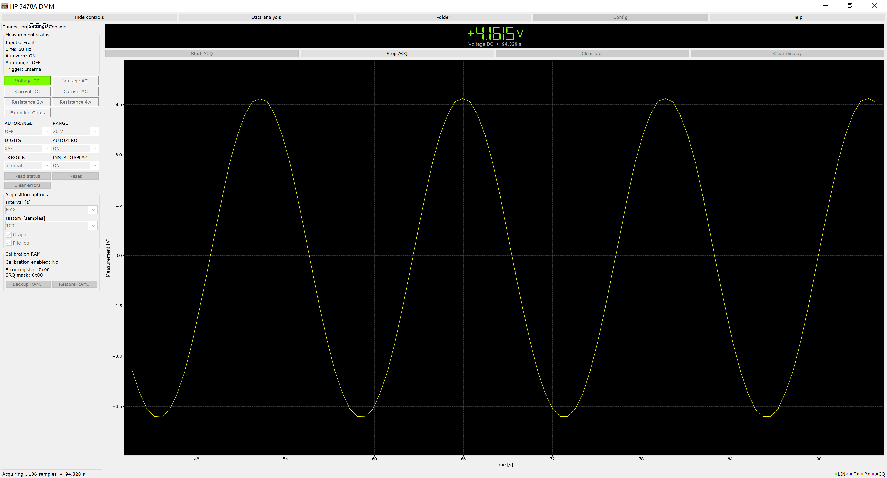
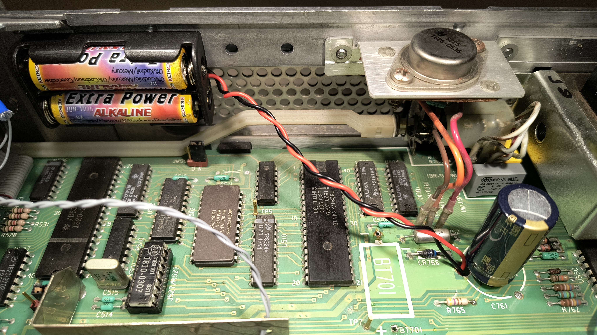
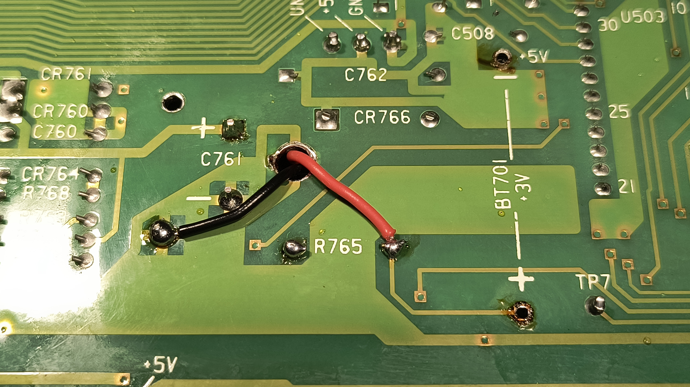
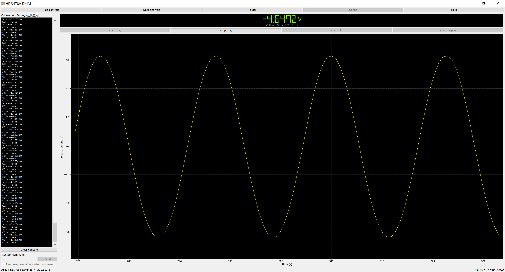
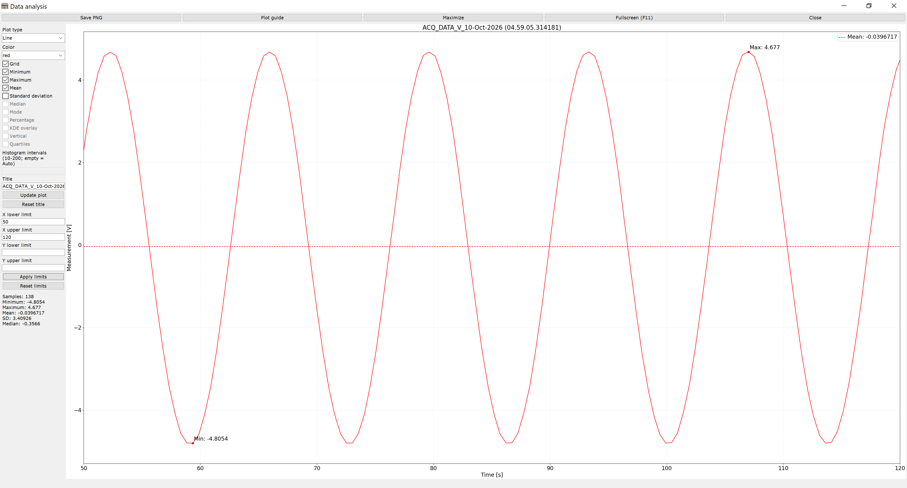

# HP 3478A DMM GUI

A Python-based graphical user interface (GUI) designed to control and monitor 
the **HP 3478A Digital Multimeter** via an **AR488 GPIB-to-Serial controller**. 



## AR488 GPIB controller
To write and debug the GPIB interface, I built a GPIB controller using an Arduino 
Nano Clone CH340G and firmware provided by 
[Twilight-Logic](https://github.com/Twilight-Logic/AR488).


## Install and run

Use Python 3.10 or later with Tkinter:

```bash
python -m pip install -r requirements.txt
python Main.py
```

On Linux, install your distribution's Tkinter package if needed, such as
`python3-tk`. The tooltip module uses the standard Python `idlelib` package,
which may require the distribution's IDLE package. On Windows, Tkinter and IDLE
are normally included with Python.

To try the program without an instrument:

```bash
python Main.py --demo --no-sound
```

Select **SIMULATED**, click **Connect**, choose a function, then click **Start
ACQ**. Demo mode never opens a physical serial device. `--windowed` starts in a
resizable window.


## Instrument settings and status

A function button or instrument combobox change sends its command immediately. 
Before every status request, the application waits one second and then sends `B`, 
reads the five raw status bytes through AR488, and updates the controls from the 
reported state. The wait happens in the I/O worker so the interface stays responsive. 
Demo mode does not need this hardware delay. For example, **Current DC** sends `F5`, 
then `RA`, waits for settling, and requests status. 
The green function button always follows the returned function code.
Programmatic updates do not send new commands.

**Inputs**, **Line**, **Autozero**, **Autorange** and **Trigger** are shown in the
Settings tab under **Measurement status**, directly above the function buttons.
The calibration enable flag, error register and SRQ mask are also in **Settings**.

Range status codes are interpreted within each function;
**Extended Ohms** has a fixed range, so its range and autorange controls are disabled.

The five status bytes do not report the instrument's display setting. This
combobox therefore shows the last successful display command, or **Unknown**
after an unrecognized custom command. Trigger status identifies internal and
external flags, but does not distinguish every trigger mode. The Trigger
combobox always uses one of **Internal**, **External**, **Single**, **Hold** or
**Fast**. A compatible last command preserves **Fast** or **Hold**; otherwise
the internal flag selects **Internal**, the external flag selects **External**,
and neither flag selects **Single**. If both flags are set, **External** takes
precedence. Selecting a mode sends the corresponding command immediately.

**Read status**, **Reset** and **Clear errors** also refresh the controls. As in
the HP protocol, requesting `B` reports and clears the instrument error
register. Configuration controls and custom commands are disabled during
acquisition.


## Communication and COM ports

Available serial ports are discovered using pySerial, refreshed automatically
and sorted naturally (COM2 before COM10). Detection does not open ports. The
current port remains selected during a connection. The default GPIB address is
23; select the instrument's configured address (1-30) before connecting.
Address zero is reserved for the controller.

The connection opens with `AR488(port, timeout=config.query_timeout, debug=False)` 
and then calls `address(address)`. The configured response timeout is 1 second.
PyAR488 opens the selected COM port at 115200 baud, waits for the board and
reads its existing configuration. Opening the port retains the driver's serial
timeout properties. After `++ver`, the session sends `++auto 0` to use explicit
reads and `++eot_enable 0` to disable serial EOT trailers. Both settings are
queried back and must report zero before the first DMM request. These are
runtime settings; no EEPROM save is requested.

ASCII commands are strings and are sent through the driver's actual
`bus_write` method, using  `\n` linefeed.

The `B` request uses `++read eoi` so the controller stops at the instrument's
EOI signal instead of continuing into a subsequent measurement. The response
is read as exactly five binary bytes using
`transport.read_binary()`, which uses sized serial reads on AR488. It does not
require a trailing CR/LF, and CR, LF, zero or EOT values inside the five-byte
payload remain data. PyAR488's `bus_read(decode=False)` still uses `readline()`;
waiting for a missing LF can consume the whole one-second query deadline,
causing a false status timeout even with a complete response already buffered.
After collecting the five bytes, the application sends `++addr` without a
parameter. This queries the controller's current GPIB address without changing
it or requesting another instrument reading. The controller processes it after
the preceding `++read eoi` has completed. Its reply must be the configured
address (for example `23`), allowing optional CR/LF after the binary payload.
Extra payload bytes cause a protocol error; missing completion causes a timeout.
An ASCII prefix such as `+044.` must not be accepted as status just because its
bits happen to describe a valid configuration.

This completion check avoids assuming a particular serial EOT representation.
The AR488 0.53 source passes its numeric `uint8_t eot_ch` to
`dataStream.print(cfg.eot_ch)`, so EOT value 4 is printed as ASCII `4` (`0x34`)
instead of raw `0x04`. Requiring a raw marker rejects a valid five-byte status
on that implementation. EOT is therefore disabled for this application's session.
Queued input is cleared immediately before each new `B` request, and the last
status is updated only after validating the complete response.
`tests/test_status_binary.py` exercises all five triggers, decimal EOT firmware,
missing or incorrect controller completion, queued measurements and delayed
ASCII fragments through the real PyAR488 driver with a serial fixture.
Physical instrument validation remains necessary.

Measurement replies have a complete response deadline of 1 second, including 
fragmented replies and the delay after sending the query. Measurement and
console data queries send **plain `++read`**; binary status and calibration
RAM queries use **`++read eoi`**. Optional trailing bytes are drained from the buffer
or already available serial data, with a bounded 50 ms availability check 
and without altering the one-second driver timeout. Once a complete response 
has been read, extra trailer bytes are discarded without rejecting unrecognized 
byte values. Serial EOT is disabled, so it cannot remove a measurement sign or
truncate its exponent.

PyAR488's `address()` call already verifies the selected GPIB address. After
opening, the session sends `++ver`, `++auto 0`, `++eot_enable 0`, verifies
`++auto` and `++eot_enable`, and then sends `++clr`, `B`, `++read eoi`.
After the five binary bytes, `++addr` confirms completion of the read. Another
status transaction runs when autorange is active, allowing the post-clear
range to settle (1 second delay). Errors identify the COM port, GPIB address
and failed stage; controller
timeouts also include any received partial text, and invalid status messages
include the received bytes in hexadecimal.
Outside acquisition, an incomplete response times out and closes the connection.
Acquisition measurement timeouts follow the retry policy described below. If a physical
connection still fails, copy the exact **Connection failed…** message from
Console so the serial/controller stage can be distinguished from the DMM stage.
An **OUT>> ++ver** line is the command sent, not a controller response. A
timeout at the version stage occurs before the first DMM `B` command.

The **Custom command** field supports Send and Enter, plus an optional response
read. `B`, `++ver` and `++read` are handled according to their response format;
other non-ASCII query responses are displayed in hexadecimal. Each completed
custom operation refreshes status. Controller commands that change the owned
connection/framing configuration are rejected to keep subsequent binary reads
consistent; change the address through Connection instead.


## Calibration RAM backup and restore

The two buttons are at the bottom of Settings, below Acquisition options.
Stop acquisition before using them. The I/O worker keeps the interface
responsive and shows progress for each phase.

**Backup RAM…** reads all 256 four-bit RAM locations twice and saves a JSON
file containing the complete image, format version, timestamp and SHA-256
integrity digest. It never sends a RAM write. The active calibration-entry
checksums are evaluated; unused entries 5, 16 and 18 need no valid checksum.
A damaged image is still saved for diagnosis, but restoration is blocked if
an active calibration checksum is invalid. Keep backups associated with the
individual multimeter they came from.

**Restore RAM…** loads and checks that file, requests confirmation in the
application and checks the physical **CAL ENABLE** flag. Enable the front-panel
CAL ENABLE switch to restore; return it to OFF afterwards. Before any write,
the program saves the current RAM as `HP3478A_before_restore_<timestamp>.json`
in the output directory. It then writes all 256 locations and reads them back.
Addresses 1-255 must match; address zero is the instrument's write-protection
test nibble and can change independently. A failure reports the saved recovery
file and does not claim a successful restoration or repeat writes automatically.

The commands are **`W` + one raw address byte** to read and **`X` + one raw
address byte + one raw data byte** to write. The address is not decimal ASCII.
A read reply is one byte in `0x40`-`0x4F`; subtract `0x40` to recover the nibble.
AR488 special bytes (CR, LF, ESC and '+') are escaped on the serial link.
Binary operations temporarily use `++eos 3`, asserted EOI and `++read eoi`;
the original EOS and EOI settings are queried only when calibration is requested
and restored afterwards. Raw single-byte RAM reads avoid waiting for a newline
that these replies do not contain. Existing PNG or CSV files are not
calibration backups. Demo mode supports the same backup/restore workflow using
simulated RAM only.

**Battery replacement…** If the old battery is still functional, the safe method 
for replacing it without the need of re-write the calibration parameter in RAM is 
to solder an external 3V battery holder in parallel with the existing battery 
(while the device is turned off and unplugged) and then desolder the old one.
 It is highly recommended to replace the mains filter capacitors 
(RIFA capacitors) and the +5V line electrolytic capacitor (chassis ground).




## Acquisition, plot and numeric display

The acquisition thread performs instrument I/O and CSV logging. A separate
queue delivers callbacks to Tkinter; worker threads never touch widgets or
call `root.after`. The GUI refreshes the numeric display and plot independently
of the sampling rate. Acquisition uses monotonic elapsed time.

During **Start ACQ**, a measurement that times out after 0.5 seconds is skipped.
It does not update the numeric display, plot history, sample count or CSV logger.
Each missed `++read` writes a **WARN** line to Console, with the consecutive
timeout count. The next measurement is requested immediately, without waiting
for the selected sampling interval. A successful measurement resets the count.
The fifth consecutive timeout stops acquisition, closes the CSV and connection,
and shows one error dialog.
Status queries and actual serial or protocol errors retain their existing
error handling. Stop during a pending timeout ends acquisition without treating
the cancellation as a lost connection.

The plot updates an existing line and scrolls through the most recent samples,
mimicking a DSO screen in **Auto (Untriggered Roll)** with 100 samples by default 
and selectable larger histories. The CSV records every successfully captured sample, 
independently of plot history or refresh rate. Overload readings are shown explicitly 
on the numeric display and are excluded from the plotted amplitude scale; the original 
numeric sentinel is retained in CSV data (full scale value).

The `digital-7.ttf` is rendered directly through Pillow, without installing a system font.
Units use the shared interface font so symbols such as Ω remain readable. 
Digital-7 is by Sizenko Alexander (Style-7); the author's original license is included in
`DIGITAL7_FONT_LICENSE.txt`.

Acquisition options are in **Settings**: interval, history, Graph and File log.
**MAX** adds no sampling interval wait. Numeric intervals range from 0.1 to
3600 seconds; actual timing is limited by the instrument and communication.
Stop interrupts interval waits immediately. A read already in progress is
allowed to complete or reach the configured query timeout (1 second). 
Closing the window also stops acquisition, closes the CSV and releases the serial
port, including when startup is still pending.

The window uses expanding grid cells and reflowing buttons. On narrow windows,
the **Controls** button toggles a bounded, scrollable pane above the acquisition
area so the waveform retains most of the available space. Labels, Entry fields
and Combobox fields/drop-downs use the same shared font. The signed numeric
reading adjusts its font to fit the available width.  



## CSV files and analysis

Program folder is defined in `settings.ini` file with `Program Path: C:\Users\<user>`.
Csv output is saved under `<program folder>/HP_3478A_DMM/OUTPUT`. Capture filenames include
microseconds and existing files are never overwritten.

**Data analysis** opens an independent figure for Line, Histogram, KDE, Box or
Violin plots. The controls retain color, grid, statistics, extrema, histogram
bins/percentage/KDE overlay, orientation, quartiles, title and axis limits.
Press Enter or **Update plot** after editing analysis text fields. Limits take
effect through **Apply limits**; **Reset limits** restores automatic scaling.
Single and constant captures are supported without a density calculation error.
**Save PNG** exports at 300 dpi with a unique filename; **Plot guide** explains
the selected plot.  



## Main classes and modules

- `app.py` — `DmmApplication` -> Compose services and handle GUI actions/lifecycle
- `transport.py` — `InstrumentTransport`, `AR488Transport`, `SimulatedTransport` -> Driver I/O, calibration bytes and simulation
- `instrument.py` — `HP3478A` -> Commands, serialized transactions and status readback
- `status.py` — `StatusDecoder`, `MeasurementDecoder` -> Binary flags and numeric readings
- `models.py` — `DmmStatus`, `Measurement`, `TraceBuffer` -> Immutable snapshots and bounded history
- `acquisition.py` — `AcquisitionController` -> Sampling, cancellation and logger lifecycle
- `storage.py` -> Preferences, output paths, CSV recording/loading
- `calibration.py` -> Complete RAM images, integrity/checksum validation and recovery files
- `plot.py` — `LiveTraceRenderer`, `LiveTracePlot`, `NumericDisplay` -> Live visualization
- `display.py` — `DigitalReadoutRenderer` -> Render the bundled Digital-7 font within the available display area
- `analysis.py`, `analysis_ui.py` -> Statistics, five analysis plots and analysis windows
- `canvas.py` -> Coalesced TkAgg resizing without clearing plots on movement
- `ui.py`, `widgets.py`, `layout.py` -> Panels and responsive layout
- `ports.py`, `tasks.py`, `dialogs.py` -> Port discovery, callback queue and shared GUI services
- `config.py` -> Function/range definitions, command mappings and preferences


## Unit Testing

```bash
python -m unittest discover -s tests -v
```
- `test_acquisition.py` -> 15 Tests
- `test_analysis_window.py` -> 8 Tests
- `test_calibration.py` -> 11 Tests
- `test_console.py` -> 8 Tests
- `test_data.py` -> 16 Tests
- `test_display.py` -> 3 Tests
- `test_protocol.py` -> 32 Tests
- `test_retry.py` -> 24 Tests
- `test_status_binary.py` -> 18 Tests
- `test_sync.py` -> 11 Tests
- `test_transport.py` -> 11 Tests


## Protocol references
- [HP 3478A operator's manual](docs/hp-3478a-operations.pdf)
- [HP 3478A service manual](docs/hp-3478a-service.pdf)
- [AR488 developer manual](https://twilight-logic.github.io/AR488/)
- [PyMeasure HP 3478A driver](https://github.com/pymeasure/pymeasure/blob/master/pymeasure/instruments/hp/hp3478A.py)


## Driver dependency
- [PyAR488](https://pypi.org/project/PyAR488/)


## RAM BACKUP
The binary RAM command format and calibration checksums were verified against
[Tom Verbeure's tested HP 3478A backup/restore implementation](https://tomverbeure.github.io/2022/12/02/HP3478A-Multimeter-Calibration-Data-Backup-and-Battery-Replacement.html).


### License
This project is licensed under the **MIT License** - see the `LICENSE` file for details. 
You are free to use, modify, and distribute this software, even for commercial purposes, 
as long as the original copyright notice is retained.

**Disclaimer**: *This software is distributed in the hope that it will be useful, 
but WITHOUT ANY WARRANTY; without even the implied warranty of MERCHANTABILITY or F
ITNESS FOR A PARTICULAR PURPOSE. Interfacing with vintage test equipment and writing 
to the physical Calibration RAM (using the `X` command) are sensitive procedures. 
The authors and contributors hold absolutely no liability for instrument damage, 
lost calibration constants, or hardware malfunctions.*


### Contributions
Contributions, bug reports, and hardware compatibility feedback are highly appreciated! 

Since the codebase has been structured with independent, decoupled classes (protocol, 
transport, acquisition, etc.), please maintain this clean object-oriented architecture 
when submitting changes.

* **Reporting Bugs**: Open an **Issue** on the repository. If you experienced a communication 
failure, please copy and paste the exact *Connection failed…* message from your Console to 
help distinguish serial/controller issues from DMM handshake errors.
* **Submitting Code**: **Fork** the repository, create a dedicated feature branch, and submit 
a **Pull Request**. For major architectural changes, please open an Issue first to discuss 
your proposal.
